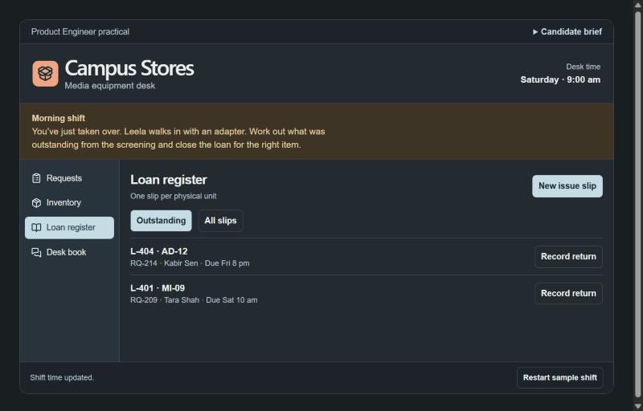
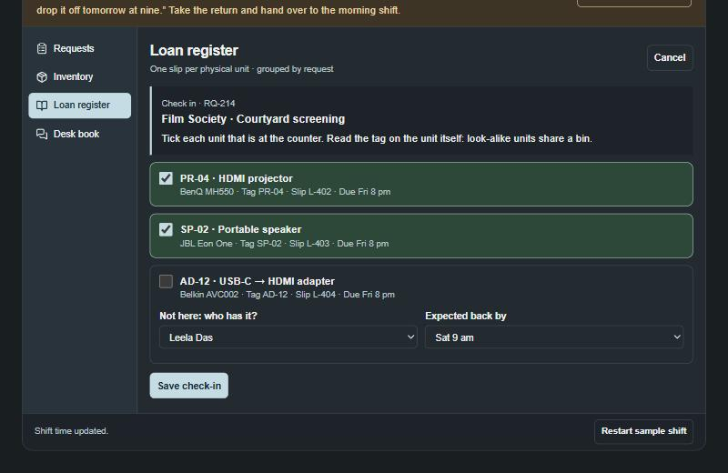
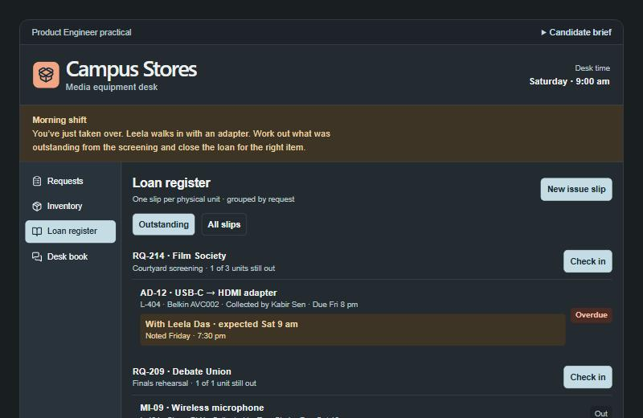

# Campus Stores

Campus Stores is a Product Engineer work sample set at a fictional campus media equipment desk. Work through a club’s screening, from equipment pickup to a partial return and the next morning’s handover. Open **Candidate brief** in the app for the assignment.

## My submission: kit check-in

**Reviewers:** the change is in `app.js` (`kit`, `slip`, `checkinForm`, `checkIn`, and the `undo` action), `styles.css`, and one button in `index.html`. Run the app, press **Restart sample shift**, and play the three moments below.

### What works well: pickup refuses the wrong kit

At 3:45 pm I tried to issue the digital camera (CA-03) against the Film Society request. The desk refused it: *"This equipment type is outside the approved request."* The projector in repair (PR-06) never appeared as an option, and a second unit of the same type is blocked too. Because there is one slip per physical unit, a partial return can be tracked at all. I kept all of this unchanged.

### What I would change: the half-return lives outside the record

At 7:30 pm Kabir returned the projector and speaker. In the original app I clicked **Record return** twice. The most important fact of the night, *Leela has the adapter and will bring it at 9 am*, had nowhere to go except a free-text desk book note, which depends on the evening person remembering to write it.

At 9 am the morning shift saw only:

> `L-404 · AD-12` · `RQ-214 · Kabir Sen · Due Fri 8 pm` · [Record return]

- It doesn't say that AD-12 is an adapter.
- It doesn't say the adapter is overdue.
- It doesn't mention Leela, who is the person standing at the counter.

There are also two look-alike adapters, AD-12 and AD-15 (same bin C4). One click closed the slip with nothing prompting a check that the right unit was in hand.



### The change

**Check in a kit, not a slip.** The loan register groups slips by request and each kit has a **Check in** button.

1. The check-in lists every unit still out on that request, by tag, type and model (for example "AD-12 · USB-C → HDMI adapter, Belkin AVC002"). You tick the units that are physically at the counter.
2. **Every unit you don't tick must say who has it and when it is expected back.** You cannot save a partial return without accounting for the rest. This is the one hard rule I added.
3. That follow-up is saved **on the slip**. The register shows it under the unit: *"With Leela Das · expected Sat 9 am · Noted Friday 7:30 pm"*.
4. The check-in writes its own desk book entry: *"Returned: PR-04, SP-02. Still out: AD-12, with Leela Das, expected Sat 9 am."* The handover is now a by-product of doing the return, not a separate chore.
5. Slips now flag **Overdue** against the desk clock and show when each unit came back.
6. **Undo check-in.** Ticking several boxes is quicker than one button per slip, but makes a mis-tick easier. Right after saving, **Undo check-in** in the status bar reopens all affected slips, removes the automatic desk book entry, and reopens the check-in to correct. It lasts until the next recorded action or until time moves on.

**Friday 7:30 pm: check-in with the adapter still out**



**Saturday 9 am: what the morning shift now sees**



### The same job with the change

| Moment | Before | After |
| --- | --- | --- |
| Fri 3:45 pm pickup | 3 slips | Unchanged: 3 slips, same validation |
| Fri 7:30 pm partial return | 2 × Record return, then write a free-text note (optional) | **Check in** → tick projector + speaker → pick *Leela Das* / *Sat 9 am* for the adapter → Save. Desk book entry is written for you. Saving without the adapter's follow-up is blocked. |
| Sat 9:00 am handover | Read desk book, match "adapter" to a tag, click Record return on the right row | Register shows the Film Society kit: *AD-12 adapter · Overdue · With Leela Das · expected Sat 9 am*. **Check in** shows only AD-12 with its model. Tick, Save → "RQ-214 complete." |

### What I kept, and what I deliberately left out

- **Kept:** one slip per unit, all issue-time validation, the desk book for human messages, the Inventory page, and the saved-progress format (older saved shifts still load).
- **Left out (pickup speed):** issuing a whole kit from one form, and filling "Return by" from the request. Pickup is slow (12 dropdown picks) but it isn't where the shift goes wrong, and one focused change is easier to judge.
- **Left out (form errors):** inline errors on the issue form. The check-in form does show its error inline.
- **Left out (scope):** barcode scanning, accounts and notifications. They aren't needed to prove the idea.

### What I'd watch at a real counter

When the person who borrowed the kit isn't the one returning the last item, **does the morning shift close the right slip without opening the desk book or asking anyone?** I'd time from "someone walks in with an item" to "slip closed", and count wrong-unit returns (AD-12 vs AD-15) before and after the change.

## Run the app

Open `index.html` in a modern browser. The app includes its scripts, styles, and icons and can run offline.

To serve it over local HTTP, run this from the repository folder and visit `http://localhost:8000`.

```sh
python3 -m http.server 8000 --bind 127.0.0.1
```

Each browser stores its own sample shift locally when browser storage is available. **Restart sample shift** restores the fictional starting records.

## Source

- `index.html` contains the desk layout, candidate brief, and bundled icons.
- `app.js` contains the sample records and interactions.
- `styles.css` defines the desktop and mobile layouts.

Icon license notices are in [third-party/lucide-LICENSE.txt](third-party/lucide-LICENSE.txt).


## Submit your work

1. [Fork Campus Stores](https://github.com/virinchi-healthcare/campus-stores/fork) into your GitHub account. Complete the candidate brief and push your changes to your public fork. In your README, point reviewers to your work and explain the decision you made.
2. In your fork, open **Commits**, select the final commit you want reviewed, and copy the page URL. It should look like `https://github.com/YOUR-USERNAME/campus-stores/commit/COMMIT-SHA`.
3. [Submit your work through the Google Form](https://docs.google.com/forms/d/e/1FAIpQLScvzoh1R4WS-SkiwAVBQbMvniieJYSoOEfLMyVo5CyjOvYUgQ/viewform). Your **roll number**, **email ID**, and **final commit link from your public fork** are required. Enter your roll number and email ID in the form only.
